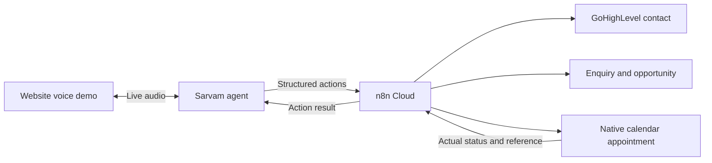

# Saavantus — GoHighLevel CRM and appointment plan

Revision 1 · October 21, 2026 · Proposed integration; no connection or implementation performed.

## Decision

Use **GoHighLevel as the CRM and its native calendars for appointments**, with Sarvam for voice and n8n Cloud for business actions. Keep the new website source in your GitHub and deployment on Hostinger. No extra scheduler is needed on the evidence reviewed.

HighLevel documents contact upsert, custom fields, opportunities, available slots and appointment creation/update. These establish product capabilities, not permission or readiness in your particular account. [Contacts](https://marketplace.gohighlevel.com/docs/ghl/contacts/upsert-contact/), [Opportunities](https://marketplace.gohighlevel.com/docs/ghl/opportunities/create-opportunity/), [Calendar APIs](https://marketplace.gohighlevel.com/docs/ghl/calendars/calendar-events/).

The website still needs server-side session/authentication routes as specified in the main plan. The diagram shows the proposed business flow, not an established integration. n8n does not carry the live audio stream.

## What happens during a future real conversation

1. Explain the AI role and the information to be saved. Confirm the caller's contact details and applicable consent; do not treat microphone permission as CRM or marketing consent.
2. Ask questions appropriate to the enquiry. Capture stated preferences, allow corrections and leave missing answers unknown.
3. n8n validates the structured fields and creates or updates the correct GoHighLevel contact only after the required ownership check. Speaking a matching phone/email or name is not authentication. Before exposing existing appointments, changing an existing person's details, or rescheduling/cancelling, use the business-approved identity verification; the clinic must approve its patient verification flow. An unverified caller can leave a new request for staff review. Attach a separate enquiry/opportunity so a repeat caller's new requirements do not erase an old enquiry.
4. Read the selected calendar's available slots. Offer real returned slots, including date and timezone. Repeat the selected slot and obtain the caller's confirmation before booking.
5. Create the native appointment with availability validation enabled. Save its ID and actual status. Only say it is confirmed when the authoritative record supports that status.
6. Save a concise factual summary and next action. Optional reminders and notifications require a deliberately configured workflow; successful booking does not establish message delivery.

During the current design stage, every record shown is fictional. The first public role-play demo should show the same shape of result without writing to production CRM. Later integration testing can use a dedicated test location/calendar with synthetic records, after separate approval. A live “book a Saavantus consultation” action must be visually separate from the property/patient role-play and save only the visitor's volunteered business-contact information.

## Information to store

“Everything collected” should mean every agreed business field and its outcome, not an unrestricted transcript dump. That keeps the record useful, searchable and less likely to contain irrelevant or sensitive information.

| Information | Destination and rule |
|---|---|
| Confirmed name, phone/email, preferred language | Contact native fields and approved language field; normalize phone with country code; never invent missing details |
| Source | Contact source identifying website and agent; preserve existing unrelated data |
| Intent | Real estate opportunity field: buy, rent, sell, lease out, or unspecified |
| Location preference | Opportunity field for city, areas and acceptable alternatives; not the contact's residential address |
| Property preferences | Type, bedrooms, purpose and must-haves relevant to the enquiry |
| Budget | Minimum/maximum when supplied, currency INR and purchase/rent period; retain phrases such as “around” or “flexible” |
| Timeline | Stated timeframe plus confirmed target date if supplied; no guessed deadline |
| Qualification | Rules-based disposition, reasons and missing fields; buyer scoring remains separate from seller intake |
| Next action | Viewing, callback, more information, staff review or no follow-up, with caller's preference |
| Preferred appointment | Requested date/time/timezone on the enquiry until a booking exists |
| Booked appointment | Native calendar event with contact, calendar, location and assigned user IDs, start/end, timezone and returned status |
| Summary | Short factual note referencing the enquiry and action outcome; no invented certainty or verbatim transcript by default |
| Consent and traceability | Controlled integration record containing purpose/version/time, session/action ID and returned CRM/event IDs |

These are proposed logical fields. Actual HighLevel custom-field, pipeline, stage and calendar IDs must be discovered and mapped before writing anything. HighLevel supports contact and opportunity custom-field discovery. [Custom fields](https://marketplace.gohighlevel.com/docs/ghl/locations/get-custom-fields/).

**Important commercial distinction:** property budget is not Saavantus revenue or opportunity monetary value. Store it as a qualification field. Revenue forecasts should use an independently defined deal-value policy.

Example: “Buy a 2 BHK in Whitefield, up to ₹1 crore, within three months; viewing Saturday at eleven.” The enquiry stores those requirements. The appointment remains **Requested** until the calendar has accepted the exact dated slot. A phrase like “Saturday” must be resolved and read back, not silently guessed.

## Proposed pipeline

Real estate: **New enquiry → Qualification in progress → Qualified / Staff review → Viewing requested → Viewing booked → Follow-up**. Lost/closed disposition requires an explicit business rule. Hot/warm/cold is a separate qualification attribute, not a substitute for booking status.

Healthcare: **Reception request → Details checked → Appointment requested → Appointment booked / Staff follow-up**. Use the native appointment status as the scheduling authority. Do not add a sales value or lead-quality score to a patient's administrative request.

Pipeline labels are a proposal; reuse suitable existing structures after inspection instead of creating parallel pipelines automatically.

## Healthcare boundary

The public demo uses made-up clinic and appointment data. Its CRM-shaped preview contains only the service request, preferred clinician/branch if relevant, visit type, language, preferred time and next administrative action.

For any later real clinic deployment, agree the minimum contact/appointment data, retention, access and system of record with the clinic. Do not send symptom histories, diagnoses, medical reports, prescriptions, insurance identifiers, identity documents or full audio/transcripts into generic CRM notes under this proposal. Even an identified appointment can be sensitive. The healthcare workflow image's broader EMR, insurance, payments, lab and pharmacy stages remain a separate roadmap; GoHighLevel does not make those integrations complete.

Keep the existing requirement for a qualified clinician to review escalation wording before the healthcare voice demo is configured or released. An emergency concern must not become a routine booking recommendation.

## Appointment reliability

- Query a specific calendar and explicit timezone. Use `Asia/Kolkata` for the initial India configuration after confirming the calendar's setting; store the UTC instant and displayed local time. Free-slot requests support timezone and a maximum 31-day range. [Available slots](https://marketplace.gohighlevel.com/docs/ghl/calendars/get-slots/).
- Preserve booking validation. Do not enable `ignoreFreeSlotValidation` or `ignoreDateRange` for visitor bookings. The API's `toNotify` defaults to true; future test setup must deliberately suppress notifications and inspect other CRM-triggered automations. [Appointment creation](https://marketplace.gohighlevel.com/docs/ghl/calendars/create-appointment/).
- An offered slot is not a reservation. Recheck before the write, handle conflicts and offer alternatives. Use a durable operation ID and concurrency protection in the integration.
- The reviewed create contract does not document an idempotency key. If a write times out, show **Checking booking result** and reconcile before retrying; a blind retry may create a duplicate. [Contact appointments](https://marketplace.gohighlevel.com/docs/ghl/contacts/get-appointments-for-contact/).
- Save returned event IDs and preserve actual statuses. `new` and `confirmed` are distinct. Reschedule through the update operation after checking availability; cancel through the cancelled status rather than deleting history. [Appointment update](https://marketplace.gohighlevel.com/docs/ghl/calendars/edit-appointment/).
- Contact save, opportunity save, appointment save and notification delivery are separate outcomes. A failed optional summary note must not cancel a successfully booked appointment.
- Reconcile changes made by staff. Signed webhook integration may be used when the appropriate app setup exists; a Private Integration token alone does not establish webhook subscriptions. Use authoritative reads where needed. [Webhook integration guide](https://marketplace.gohighlevel.com/docs/webhook/WebhookIntegrationGuide/).

## Contact identity and repeat enquiries

HighLevel upsert follows the location's email/phone duplicate settings. Conflicting email and phone matches can select the priority match rather than merging records. Validate identity and hold conflicts for review; reuse returned IDs. Contact upsert does not prevent duplicate opportunities or appointments. Preserve existing tags and unrelated fields. [Upsert behaviour](https://marketplace.gohighlevel.com/docs/ghl/contacts/upsert-contact/).

Permit a contact to have multiple legitimate enquiries. Tie each session to the correct enquiry through a stable internal identifier, not name alone. Do not overwrite an old property's preferences simply because the same person calls again.

## Future access and prerequisites

For a single owned sub-account, a scoped server-to-server Private Integration is a reasonable starting option; multi-client installation may justify OAuth. Store credentials only in n8n/backend credential storage. Neither option is connected now. [Private Integration tokens](https://marketplace.gohighlevel.com/docs/Authorization/PrivateIntegrationsToken/).

Before implementation, inspect the selected location, existing pipeline/custom fields, target calendars, availability rules, timezone, users, notification workflows and actual API access. Candidate permissions are contact read/write, calendar read, event read/write, opportunity read/write and custom-field read. No broad agency-administration access is needed for the proposed flow. [Scope matrix](https://marketplace.gohighlevel.com/docs/Authorization/Scopes/).

The current public docs use `Version: v3`; pin a supported contract and check the n8n connector's actual endpoint coverage. Prefer its native node where it correctly supports the required operations; otherwise use n8n's authenticated HTTP Request node against the official API. That changes the adapter, not the chosen provider. [API versioning](https://marketplace.gohighlevel.com/docs/Versioning/).

No credentials are needed for this design review. Later prerequisites include the location/calendar IDs, controlled test environment, consent/retention decisions and separate approval for real CRM writes and scheduling.

## Acceptance checks for the later integration

Use synthetic records in the approved test location. Check both English and Hindi capture of area, intent, INR budgets and dates; corrections and incomplete details; repeated callers; conflicting email/phone matches; attempted impersonation using another person's contact details; denial of existing-record disclosure or changes without verification; double submissions; concurrent slot selection; unavailable times; timeout after successful booking; rescheduling/cancellation; notification side effects; unknown timezone; and healthcare data minimisation. Verify the actual CRM fields and calendar record, not merely a successful n8n execution.

**Completion for this stage:** documentation and visual previews only. No account access was attempted, no contact or appointment was created, and no message was sent.
